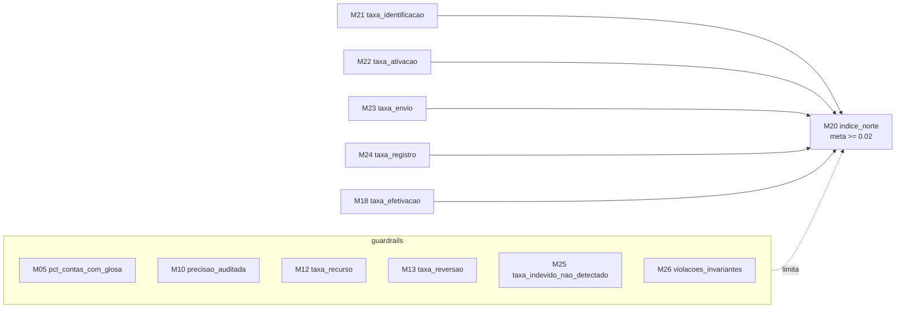

<!-- GERADO por `python -m arquitetura.gerar` a partir de arquitetura/modelo.yaml. NÃO EDITE À MÃO. -->
# Arquitetura de dados: Arvo × Parthenon · Hospital São Rafael

Fonte da verdade: [`modelo.yaml`](modelo.yaml). Diagrama editável: [`arquitetura.drawio`](arquitetura.drawio). Grafo consultável: [`grafo.json`](grafo.json) (`python -m arquitetura.consultar`).

**Legenda de status:** borda contínua = implementado · tracejada = especificado/futuro (fase indicada).

| Camada | Papel |
|---|---|
| `fonte` | Sistemas e arquivos externos |
| `bronze` | Bruto, append-only, fiel à origem (tudo string + metadados de ingestão) |
| `quarantine` | Registros reprovados nas expectations, com motivo |
| `silver` | Tipado, validado, deduplicado e enriquecido com a semântica |
| `contracts` | Contrato como dado (F3): parâmetros aprovados |
| `semantic` | Glossário, conceitos e mapas (F2) |
| `gold` | Modelo dimensional (estrela): fatos e dimensões de negócio |
| `gold_shadow` | Só em prod: saída do agente em modo sombra, lida pela auditoria e nunca enviada (F10) |
| `metric` | UC Metric Views: métricas definidas uma vez (F2) |
| `ops` | Telemetria, estado e qualidade |

## 1. Linhagem do medalhão

```mermaid
flowchart LR
  subgraph fonte["fonte"]
    fonte__sinistro_csv[("fonte.sinistro_csv<br/><i>implementado</i>")]
    fonte__contrato_pdf[("fonte.contrato_pdf<br/><i>implementado</i>")]
    fonte__planilha_inteligencias[("fonte.planilha_inteligencias<br/><i>implementado</i>")]
    fonte__semantica_git[("fonte.semantica_git<br/><i>implementado</i>")]
    fonte__recursos_prestador[("fonte.recursos_prestador<br/><i>futuro</i>")]
    fonte__eventos_funil_operadora[("fonte.eventos_funil_operadora<br/><i>futuro</i>")]
    fonte__gabarito_auditoria[("fonte.gabarito_auditoria<br/><i>implementado</i>")]
    fonte__auditoria_amostral[("fonte.auditoria_amostral<br/><i>futuro</i>")]
  end
  subgraph bronze["bronze"]
    bronze__sinistro_raw["bronze.sinistro_raw<br/><i>implementado · F5</i>"]
    bronze__gabarito_raw["bronze.gabarito_raw<br/><i>implementado · F8</i>"]
    bronze__inteligencias_raw["bronze.inteligencias_raw<br/><i>implementado · F5</i>"]
  end
  subgraph quarantine["quarantine"]
    quarantine__item_conta_rejeitado["quarantine.item_conta_rejeitado<br/><i>implementado · F5</i>"]
  end
  subgraph silver["silver"]
    silver__item_conta["silver.item_conta<br/><i>implementado · F5</i>"]
    silver__conta["silver.conta<br/><i>implementado · F5</i>"]
    silver__atendimento["silver.atendimento<br/><i>implementado · F5</i>"]
    silver__funil_inteligencia["silver.funil_inteligencia<br/><i>implementado · F5</i>"]
  end
  subgraph contracts["contracts"]
    contracts__contract_params["contracts.contract_params<br/><i>implementado · F3</i>"]
  end
  subgraph semantic["semantic"]
    semantic__map_tuss_conceito["semantic.map_tuss_conceito<br/><i>implementado · F2</i>"]
    semantic__dim_dominio_valor["semantic.dim_dominio_valor<br/><i>implementado · F2</i>"]
  end
  subgraph gold["gold"]
    gold__dim_data["gold.dim_data<br/><i>implementado · F5</i>"]
    gold__dim_prestador["gold.dim_prestador<br/><i>implementado · F5</i>"]
    gold__dim_item_tuss["gold.dim_item_tuss<br/><i>implementado · F5</i>"]
    gold__dim_perfil_atendimento["gold.dim_perfil_atendimento<br/><i>implementado · F5</i>"]
    gold__dim_contrato["gold.dim_contrato<br/><i>implementado · F5</i>"]
    gold__dim_item_contratado["gold.dim_item_contratado<br/><i>implementado · F5</i>"]
    gold__dim_regra["gold.dim_regra<br/><i>implementado · F6</i>"]
    gold__dim_inteligencia["gold.dim_inteligencia<br/><i>implementado · F5</i>"]
    gold__fato_item[["gold.fato_item<br/><i>implementado · F5</i>"]]
    gold__fato_item_auditado[["gold.fato_item_auditado<br/><i>implementado · F6</i>"]]
    gold__fato_apontamento[["gold.fato_apontamento<br/><i>implementado · F6</i>"]]
    gold__fato_funil_economia[["gold.fato_funil_economia<br/><i>implementado · F5</i>"]]
    gold__fato_glosa_ciclo[["gold.fato_glosa_ciclo<br/><i>futuro · F10</i>"]]
    gold__fato_excedente_mensal[["gold.fato_excedente_mensal<br/><i>especificado · F9</i>"]]
    gold__fato_auditoria_amostral[["gold.fato_auditoria_amostral<br/><i>implementado · F8</i>"]]
    gold__dim_etapa_funil["gold.dim_etapa_funil<br/><i>especificado · F10</i>"]
    gold__dim_motivo["gold.dim_motivo<br/><i>especificado · F10</i>"]
    gold__ponte_regra_inteligencia["gold.ponte_regra_inteligencia<br/><i>implementado · F6</i>"]
    gold__ref_linha_base_excedente["gold.ref_linha_base_excedente<br/><i>especificado · F9</i>"]
    gold__v_avaliacao_gabarito["gold.v_avaliacao_gabarito<br/><i>implementado · F8</i>"]
  end
  subgraph gold_shadow["gold_shadow"]
    gold_shadow__fato_apontamento[["gold_shadow.fato_apontamento<br/><i>especificado · F10</i>"]]
  end
  subgraph metric["metric"]
    semantic__mv_auditoria_glosa["semantic.mv_auditoria_glosa<br/><i>especificado · F2</i>"]
    semantic__mv_funil_economia["semantic.mv_funil_economia<br/><i>especificado · F2</i>"]
    semantic__mv_apontamento["semantic.mv_apontamento<br/><i>especificado · F6</i>"]
    semantic__mv_glosa_ciclo["semantic.mv_glosa_ciclo<br/><i>futuro · F10</i>"]
    semantic__mv_excedente_mensal["semantic.mv_excedente_mensal<br/><i>especificado · F9</i>"]
    semantic__mv_qualidade_auditoria["semantic.mv_qualidade_auditoria<br/><i>implementado · F8</i>"]
  end
  subgraph ops["ops"]
    ops__dq_resultados["ops.dq_resultados<br/><i>implementado · F5</i>"]
    ops__llm_calls["ops.llm_calls<br/><i>implementado · F3</i>"]
    ops__v_ia_sanidade["ops.v_ia_sanidade<br/><i>implementado · F7</i>"]
    ops__v_precisao_recall["ops.v_precisao_recall<br/><i>implementado · F8</i>"]
    ops__v_sanidade_status["ops.v_sanidade_status<br/><i>implementado · F9</i>"]
    ops__ia_aceite_golden["ops.ia_aceite_golden<br/><i>especificado · F7</i>"]
    ops__ia_sugestoes_conceito["ops.ia_sugestoes_conceito<br/><i>especificado · F7</i>"]
    ops__avaliacao_resultados["ops.avaliacao_resultados<br/><i>especificado · F8</i>"]
    ops__rollout_estado_regra["ops.rollout_estado_regra<br/><i>especificado · F10</i>"]
    ops__rollout_destino["ops.rollout_destino<br/><i>especificado · F10</i>"]
  end
  fonte__sinistro_csv --> bronze__sinistro_raw
  fonte__gabarito_auditoria --> bronze__gabarito_raw
  fonte__planilha_inteligencias --> bronze__inteligencias_raw
  bronze__sinistro_raw --> quarantine__item_conta_rejeitado
  fonte__semantica_git --> semantic__map_tuss_conceito
  fonte__semantica_git --> semantic__dim_dominio_valor
  fonte__contrato_pdf --> contracts__contract_params
  bronze__sinistro_raw --> silver__item_conta
  semantic__map_tuss_conceito --> silver__item_conta
  semantic__dim_dominio_valor --> silver__item_conta
  silver__item_conta --> silver__conta
  silver__conta --> silver__atendimento
  silver__item_conta --> silver__atendimento
  bronze__inteligencias_raw --> silver__funil_inteligencia
  silver__item_conta --> gold__dim_data
  silver__item_conta --> gold__dim_prestador
  semantic__map_tuss_conceito --> gold__dim_item_tuss
  semantic__dim_dominio_valor --> gold__dim_perfil_atendimento
  contracts__contract_params --> gold__dim_contrato
  contracts__contract_params --> gold__dim_item_contratado
  contracts__contract_params --> gold__dim_regra
  fonte__semantica_git --> gold__dim_regra
  silver__funil_inteligencia --> gold__dim_inteligencia
  silver__item_conta --> gold__fato_item
  silver__conta --> gold__fato_item
  gold__dim_item_contratado --> gold__fato_item
  gold__dim_perfil_atendimento --> gold__fato_item
  gold__fato_item --> gold__fato_item_auditado
  gold__fato_apontamento --> gold__fato_item_auditado
  gold__fato_item --> gold__fato_apontamento
  silver__conta --> gold__fato_apontamento
  gold__dim_regra --> gold__fato_apontamento
  gold__dim_item_contratado --> gold__fato_apontamento
  gold__dim_contrato --> gold__fato_apontamento
  silver__funil_inteligencia --> gold__fato_funil_economia
  gold__fato_apontamento -.-> gold__fato_glosa_ciclo
  gold__ponte_regra_inteligencia -.-> gold__fato_glosa_ciclo
  fonte__eventos_funil_operadora -.-> gold__fato_glosa_ciclo
  fonte__recursos_prestador -.-> gold__fato_glosa_ciclo
  gold__fato_item -.-> gold__fato_excedente_mensal
  gold__fato_apontamento -.-> gold__fato_excedente_mensal
  gold__ref_linha_base_excedente -.-> gold__fato_excedente_mensal
  gold__v_avaliacao_gabarito --> gold__fato_auditoria_amostral
  fonte__semantica_git -.-> gold__dim_etapa_funil
  fonte__semantica_git -.-> gold__dim_motivo
  fonte__semantica_git --> gold__ponte_regra_inteligencia
  gold__fato_item -.-> gold__ref_linha_base_excedente
  gold__fato_item_auditado -.-> semantic__mv_auditoria_glosa
  gold__fato_funil_economia -.-> semantic__mv_funil_economia
  gold__fato_apontamento -.-> semantic__mv_apontamento
  gold__fato_glosa_ciclo -.-> semantic__mv_glosa_ciclo
  gold__fato_excedente_mensal -.-> semantic__mv_excedente_mensal
  gold__fato_auditoria_amostral --> semantic__mv_qualidade_auditoria
  bronze__sinistro_raw --> ops__dq_resultados
  fonte__contrato_pdf --> ops__llm_calls
  ops__llm_calls --> ops__v_ia_sanidade
  gold__fato_item_auditado --> gold__v_avaliacao_gabarito
  bronze__gabarito_raw --> gold__v_avaliacao_gabarito
  gold__v_avaliacao_gabarito --> ops__v_precisao_recall
  semantic__mv_auditoria_glosa --> ops__v_sanidade_status
  semantic__mv_funil_economia --> ops__v_sanidade_status
  semantic__mv_apontamento --> ops__v_sanidade_status
  semantic__mv_glosa_ciclo --> ops__v_sanidade_status
  semantic__mv_qualidade_auditoria --> ops__v_sanidade_status
  gold__fato_item_auditado --> ops__v_sanidade_status
  gold__fato_apontamento --> ops__v_sanidade_status
  gold__fato_funil_economia --> ops__v_sanidade_status
  gold__fato_auditoria_amostral --> ops__v_sanidade_status
  ops__dq_resultados --> ops__v_sanidade_status
  ops__v_ia_sanidade --> ops__v_sanidade_status
  quarantine__item_conta_rejeitado --> ops__v_sanidade_status
  bronze__sinistro_raw --> ops__v_sanidade_status
  fonte__contrato_pdf -.-> ops__ia_aceite_golden
  fonte__semantica_git -.-> ops__ia_aceite_golden
  quarantine__item_conta_rejeitado -.-> ops__ia_sugestoes_conceito
  semantic__map_tuss_conceito -.-> ops__ia_sugestoes_conceito
  gold__fato_item_auditado -.-> ops__avaliacao_resultados
  fonte__gabarito_auditoria -.-> ops__avaliacao_resultados
  gold__fato_auditoria_amostral -.-> ops__avaliacao_resultados
  gold__fato_apontamento -.-> gold_shadow__fato_apontamento
  ops__rollout_destino -.-> gold_shadow__fato_apontamento
  ops__v_sanidade_status -.-> ops__rollout_estado_regra
  gold__fato_apontamento -.-> ops__rollout_destino
  gold__fato_item_auditado -.-> ops__rollout_destino
  ops__rollout_estado_regra -.-> ops__rollout_destino
  ops__v_sanidade_status -.-> ops__rollout_destino
  style fonte__recursos_prestador stroke-dasharray: 5 5
  style fonte__eventos_funil_operadora stroke-dasharray: 5 5
  style fonte__auditoria_amostral stroke-dasharray: 5 5
  style gold__fato_glosa_ciclo stroke-dasharray: 5 5
  style gold__fato_excedente_mensal stroke-dasharray: 5 5
  style gold__dim_etapa_funil stroke-dasharray: 5 5
  style gold__dim_motivo stroke-dasharray: 5 5
  style gold__ref_linha_base_excedente stroke-dasharray: 5 5
  style semantic__mv_auditoria_glosa stroke-dasharray: 5 5
  style semantic__mv_funil_economia stroke-dasharray: 5 5
  style semantic__mv_apontamento stroke-dasharray: 5 5
  style semantic__mv_glosa_ciclo stroke-dasharray: 5 5
  style semantic__mv_excedente_mensal stroke-dasharray: 5 5
  style ops__ia_aceite_golden stroke-dasharray: 5 5
  style ops__ia_sugestoes_conceito stroke-dasharray: 5 5
  style ops__avaliacao_resultados stroke-dasharray: 5 5
  style gold_shadow__fato_apontamento stroke-dasharray: 5 5
  style ops__rollout_estado_regra stroke-dasharray: 5 5
  style ops__rollout_destino stroke-dasharray: 5 5
```

## 2. Modelo dimensional (gold)

Estrela: fatos no centro, dimensões conformadas ao redor. `fato_item` (F5) é a base. `fato_item_auditado` e `fato_apontamento` (F6) adicionam o resultado do motor de regras.

```mermaid
erDiagram
  gold__dim_data {
    date data PK
    date competencia
    int ano
    int mes
    string nome_mes
    int dia_semana
    boolean fim_de_semana
  }
  gold__dim_prestador {
    string id_prestador PK
    string nome_prestador
  }
  gold__dim_item_tuss {
    string cod_tuss PK
    string descricao_canonica
    string conceito
    string conceito_pai
    string tipo_item_origem
    int porte_sala
  }
  gold__dim_perfil_atendimento {
    string sk_perfil PK
    string carater_canonico
    string regime
    boolean conflito_semantico
    string descricao
  }
  gold__dim_contrato {
    string versao_contrato PK
    string id_contrato
    string id_prestador
    date vigencia_inicio
    date vigencia_fim
    string aprovado_por
    string data_aprovacao
    boolean vigente
  }
  gold__dim_item_contratado {
    string versao_contrato PK
    string cod_tuss PK
    decimal vl_teto
    boolean procedimento_em_pacote
    string taxa_sala_do_pacote
    boolean material_incluso_no_pacote
    array carater_permitido
  }
  gold__dim_regra {
    string regra_id PK
    string versao_regra PK
    string nome
    string clausula
    string tipo
    string tipo_glosa
    int prioridade
    string versao_contrato
    string defensabilidade
  }
  gold__dim_inteligencia {
    string inteligencia PK
    string tipo_inteligencia
  }
  gold__fato_item {
    string id_item PK
    string id_conta
    string id_prestador FK
    string id_beneficiario_hash
    date competencia
    date dt_atendimento FK
    string sk_perfil FK
    string carater_canonico
    string carater_origem
    string regime
    string cod_tuss FK
    string conceito
    string conceito_pai
    int qtd
    decimal vl_unitario
    decimal vl_cobrado
    boolean tem_preco_pactuado
    decimal vl_teto_unitario
    decimal vl_excedente_potencial
    boolean conta_tem_pacote
    boolean conflito_semantico
    string versao_contrato FK
    string versao_semantica
    string run_id
  }
  gold__fato_item_auditado {
    string id_item PK
    string id_conta
    string id_prestador
    string id_beneficiario_hash
    date competencia
    date dt_atendimento FK
    string carater_canonico
    string carater_origem
    string regime
    string cod_tuss FK
    string conceito
    string conceito_pai
    int qtd
    decimal vl_unitario
    decimal vl_cobrado
    boolean tem_preco_pactuado
    decimal vl_teto_unitario
    decimal vl_excedente_potencial
    boolean conta_tem_pacote
    boolean conflito_semantico
    boolean glosado
    string regra_principal
    string clausula_principal
    decimal vl_glosado
    string versao_contrato FK
    string versao_semantica
    string run_id
  }
  gold__fato_apontamento {
    string id_apontamento PK
    string id_item
    string id_conta
    string regra_principal FK
    string clausula_principal
    array clausulas_subsidiarias
    decimal vl_cobrado
    decimal vl_referencia
    decimal vl_glosado
    string justificativa
    array evidencia
    string versao_regra
    string versao_contrato FK
    string versao_semantica
    string run_id
    string status_envio
    string motivo_revisao
  }
  gold__fato_funil_economia {
    date competencia PK
    string cliente
    string inteligencia PK
    string tipo_inteligencia
    string status_inteligencia
    decimal vl_identificado
    decimal vl_enviado_operadora
    decimal vl_enviado_prestador
    decimal vl_efetivado
    double taxa_efetivacao_benchmark
    decimal vl_sinistro_processado
  }
  gold__fato_glosa_ciclo {
    string id_apontamento PK
    string id_item
    string id_conta
    string id_prestador FK
    string regra_principal FK
    string inteligencia FK
    string cod_tuss FK
    string versao_contrato FK
    date competencia
    string etapa_atual FK
    date dt_identificacao FK
    date dt_envio_operadora
    date dt_registro_prestador
    date dt_recurso
    date dt_julgamento
    date dt_efetivacao
    string motivo_retencao FK
    string motivo_registro FK
    string motivo_reversao FK
    decimal vl_identificado
    decimal vl_enviado_operadora
    decimal vl_registrado_prestador
    decimal vl_recorrido
    decimal vl_revertido
    decimal vl_efetivado
    int dias_ate_envio
    int dias_ate_registro
    int dias_ate_efetivacao
  }
  gold__fato_excedente_mensal {
    string id_prestador PK
    string conceito PK
    date competencia PK
    decimal vl_apresentado
    decimal vl_excedente
    double taxa_excedente
    double taxa_excedente_base
    string versao_linha_base FK
    boolean teve_glosa_mes_anterior
    decimal economia_preventiva_estimada
  }
  gold__fato_auditoria_amostral {
    string id_item PK
    string rodada PK
    string estrato
    string subestrato
    double peso_amostral
    string regra_principal FK
    boolean agente_indevido
    boolean auditor_indevido
    string auditor
    string motivo
  }
  gold__dim_etapa_funil {
    string etapa PK
    int ordem
    string descricao
    string dono
  }
  gold__dim_motivo {
    string id_motivo PK
    string etapa
    string categoria
    string descricao
  }
  gold__ponte_regra_inteligencia {
    string regra_id PK
    string inteligencia PK
    string tipo_vinculo
    string status_validacao
  }
  gold__ref_linha_base_excedente {
    string id_prestador PK
    string conceito PK
    string versao_linha_base PK
    date periodo_inicio
    date periodo_fim
    double taxa_excedente_base
    string aprovado_por
  }
  gold__v_avaliacao_gabarito {
  }
  gold__dim_contrato ||--o{ gold__dim_item_contratado : "versao_contrato"
  gold__dim_item_tuss ||--o{ gold__dim_item_contratado : "cod_tuss"
  gold__dim_prestador ||--o{ gold__fato_item : "id_prestador"
  gold__dim_data ||--o{ gold__fato_item : "dt_atendimento"
  gold__dim_item_tuss ||--o{ gold__fato_item : "cod_tuss"
  gold__dim_perfil_atendimento ||--o{ gold__fato_item : "sk_perfil"
  gold__dim_contrato ||--o{ gold__fato_item : "versao_contrato"
  gold__dim_item_tuss ||--o{ gold__fato_item_auditado : "cod_tuss"
  gold__dim_data ||--o{ gold__fato_item_auditado : "dt_atendimento"
  gold__dim_contrato ||--o{ gold__fato_item_auditado : "versao_contrato"
  gold__dim_regra ||--o{ gold__fato_apontamento : "regra_principal"
  gold__dim_contrato ||--o{ gold__fato_apontamento : "versao_contrato"
  gold__dim_inteligencia ||--o{ gold__fato_funil_economia : "inteligencia"
  gold__dim_data ||--o{ gold__fato_funil_economia : "competencia"
  gold__fato_apontamento ||--o{ gold__fato_glosa_ciclo : "id_apontamento"
  gold__dim_prestador ||--o{ gold__fato_glosa_ciclo : "id_prestador"
  gold__dim_regra ||--o{ gold__fato_glosa_ciclo : "regra_principal"
  gold__dim_inteligencia ||--o{ gold__fato_glosa_ciclo : "inteligencia"
  gold__dim_item_tuss ||--o{ gold__fato_glosa_ciclo : "cod_tuss"
  gold__dim_contrato ||--o{ gold__fato_glosa_ciclo : "versao_contrato"
  gold__dim_data ||--o{ gold__fato_glosa_ciclo : "dt_identificacao"
  gold__dim_etapa_funil ||--o{ gold__fato_glosa_ciclo : "etapa_atual"
  gold__dim_motivo ||--o{ gold__fato_glosa_ciclo : "motivo_retencao"
  gold__dim_motivo ||--o{ gold__fato_glosa_ciclo : "motivo_registro"
  gold__dim_motivo ||--o{ gold__fato_glosa_ciclo : "motivo_reversao"
  gold__dim_prestador ||--o{ gold__fato_excedente_mensal : "id_prestador"
  gold__dim_data ||--o{ gold__fato_excedente_mensal : "competencia"
  gold__ref_linha_base_excedente ||--o{ gold__fato_excedente_mensal : "versao_linha_base"
  gold__fato_item_auditado ||--o{ gold__fato_auditoria_amostral : "id_item"
  gold__dim_regra ||--o{ gold__fato_auditoria_amostral : "regra_principal"
  gold__dim_regra ||--o{ gold__ponte_regra_inteligencia : "regra_id"
  gold__dim_inteligencia ||--o{ gold__ponte_regra_inteligencia : "inteligencia"
```

## 3. Catálogo de tabelas

| Tabela | Tipo | Grão | Chave | Status | Fase | Origem |
|---|---|---|---|---|---|---|
| `fonte.sinistro_csv` 🔒 | fonte | Arquivo de itens de conta do prestador (CSV PT-BR, UTF-8 BOM), entregue pela TI da Parthenon no Volume bronze.landing | — | implementado | — | — |
| `fonte.contrato_pdf` | fonte | PDF do contrato de credenciamento (Volume contracts.raw) | — | implementado | — | — |
| `fonte.planilha_inteligencias` | fonte | Planilha 'Inteligências após 6 meses' (funil de economia da Arvo) | — | implementado | — | — |
| `fonte.semantica_git` | fonte | YAMLs versionados da camada semântica (semantic/*.yaml) | — | implementado | — | — |
| `fonte.recursos_prestador` | fonte | Retorno dos recursos de glosa (sistema da operadora); necessário para taxa de recurso e reversão | — | futuro | — | — |
| `fonte.eventos_funil_operadora` | fonte | Eventos por glosa no sistema da Parthenon: envio, registro, decisão da auditoria com motivo (AMB-18) | — | futuro | — | — |
| `fonte.gabarito_auditoria` | fonte | Gabarito do case (263 itens rotulados). Amostra ENRIQUECIDA e com ruído de rótulo: ver F8 | — | implementado | — | — |
| `fonte.auditoria_amostral` | fonte | Decisões dos auditores na amostra estratificada (shadow e produção), F8/F10. Entram em gold.fato_auditoria_amostral como novas rodadas, ao lado da R0 (gabarito) | — | futuro | — | — |
| `bronze.sinistro_raw` 🔒 | raw | 1 linha por linha recebida no arquivo (sem deduplicar) | _arquivo, _hash_linha | implementado | F5 | `fonte.sinistro_csv` |
| `bronze.gabarito_raw` | raw | 1 linha por item rotulado no gabarito do case (sobrescrita a cada carga) | id_item | implementado | F8 | `fonte.gabarito_auditoria` |
| `bronze.inteligencias_raw` | raw | 1 linha por inteligência por arquivo recebido | _arquivo, inteligencia | implementado | F5 | `fonte.planilha_inteligencias` |
| `quarantine.item_conta_rejeitado` | quarentena | 1 linha por linha de bronze reprovada em expectation de severidade quarentena/fail | _arquivo, _hash_linha | implementado | F5 | `bronze.sinistro_raw` |
| `semantic.map_tuss_conceito` | semantica | 1 linha por código TUSS | cod_tuss | implementado | F2 | `fonte.semantica_git` |
| `semantic.dim_dominio_valor` | semantica | 1 linha por domínio × valor de origem | dominio, valor_origem | implementado | F2 | `fonte.semantica_git` |
| `contracts.contract_params` | contrato | 1 linha por versão aprovada de contrato | versao_contrato | implementado | F3 | `fonte.contrato_pdf` |
| `silver.item_conta` | conformada | 1 linha por item de conta válido (id_item único) | id_item | implementado | F5 | `bronze.sinistro_raw`, `semantic.map_tuss_conceito`, `semantic.dim_dominio_valor` |
| `silver.conta` | conformada | 1 linha por conta | id_conta | implementado | F5 | `silver.item_conta` |
| `silver.atendimento` | conformada | 1 linha por beneficiário × dia (conceito derivado T11) | id_beneficiario_hash, dt_atendimento | implementado | F5 | `silver.conta`, `silver.item_conta` |
| `silver.funil_inteligencia` | conformada | 1 linha por inteligência × competência | competencia, inteligencia | implementado | F5 | `bronze.inteligencias_raw` |
| `gold.dim_data` | dimensao (SCD 0) | 1 linha por dia do calendário | data | implementado | F5 | `silver.item_conta` |
| `gold.dim_prestador` | dimensao (SCD 1) | 1 linha por prestador | id_prestador | implementado | F5 | `silver.item_conta` |
| `gold.dim_item_tuss` | dimensao (SCD 1) | 1 linha por código TUSS (dimensão conformada; vem da semântica) | cod_tuss | implementado | F5 | `semantic.map_tuss_conceito` |
| `gold.dim_perfil_atendimento` | dimensao (SCD 0) | 1 linha por combinação caráter × regime (junk dimension) | sk_perfil | implementado | F5 | `semantic.dim_dominio_valor` |
| `gold.dim_contrato` | dimensao (SCD 2) | 1 linha por versão de contrato (histórico preservado) | versao_contrato | implementado | F5 | `contracts.contract_params` |
| `gold.dim_item_contratado` | dimensao (SCD 2) | 1 linha por versão de contrato × código (teto e papéis contratuais) | versao_contrato, cod_tuss | implementado | F5 | `contracts.contract_params` |
| `gold.dim_regra` | dimensao (SCD 2) | 1 linha por regra × versão | regra_id, versao_regra | implementado | F6 | `contracts.contract_params`, `fonte.semantica_git` |
| `gold.dim_inteligencia` | dimensao (SCD 1) | 1 linha por inteligência Arvo | inteligencia | implementado | F5 | `silver.funil_inteligencia` |
| `gold.fato_item` | fato_transacao | 1 linha por item de conta (antes do motor de regras) | id_item | implementado | F5 | `silver.item_conta`, `silver.conta`, `gold.dim_item_contratado`, `gold.dim_perfil_atendimento` |
| `gold.fato_item_auditado` | fato_transacao | 1 linha por item de conta, com o resultado do motor de regras | id_item | implementado | F6 | `gold.fato_item`, `gold.fato_apontamento` |
| `gold.fato_apontamento` | fato_transacao | 1 linha por glosa (no máximo 1 por item) | id_apontamento | implementado | F6 | `gold.fato_item`, `silver.conta`, `gold.dim_regra`, `gold.dim_item_contratado`, `gold.dim_contrato` |
| `gold.fato_funil_economia` | fato_snapshot_periodico | 1 linha por inteligência × competência (foto mensal do funil) | competencia, inteligencia | implementado | F5 | `silver.funil_inteligencia` |
| `gold.fato_glosa_ciclo` | fato_snapshot_acumulado | 1 linha por glosa, atualizada a cada marco do ciclo de vida (identificada → efetivada) | id_apontamento | futuro | F10 | `gold.fato_apontamento`, `gold.ponte_regra_inteligencia`, `fonte.eventos_funil_operadora`, `fonte.recursos_prestador` |
| `gold.fato_excedente_mensal` | fato_snapshot_periodico | 1 linha por prestador × conceito × competência | id_prestador, conceito, competencia | especificado | F9 | `gold.fato_item`, `gold.fato_apontamento`, `gold.ref_linha_base_excedente` |
| `gold.fato_auditoria_amostral` | fato_transacao | 1 linha por item auditado na amostra estratificada (glosados e NÃO glosados), com peso amostral (F8). Hoje: rodada R0 = gabarito do case | id_item, rodada | implementado | F8 | `gold.v_avaliacao_gabarito` |
| `gold.dim_etapa_funil` | dimensao (SCD 0) | 1 linha por etapa do ciclo de vida da glosa | etapa | especificado | F10 | `fonte.semantica_git` |
| `gold.dim_motivo` | dimensao (SCD 1) | 1 linha por motivo (RET-*, REG-*, REC-*); dimensão com papéis (retenção, registro, reversão) | id_motivo | especificado | F10 | `fonte.semantica_git` |
| `gold.ponte_regra_inteligencia` | ponte | 1 linha por regra contratual × inteligência Arvo | regra_id, inteligencia | implementado | F6 | `fonte.semantica_git` |
| `gold.ref_linha_base_excedente` | dimensao (SCD 2) | 1 linha por prestador × conceito × versão da linha de base (congelada e aprovada) | id_prestador, conceito, versao_linha_base | especificado | F9 | `gold.fato_item` |
| `semantic.mv_auditoria_glosa` | metric_view | auditoria contratual (M01–M09, M27) | — | especificado | F2 | `gold.fato_item_auditado` |
| `semantic.mv_funil_economia` | metric_view | norte, meta e fatores (M14–M24) sobre o funil agregado | — | especificado | F2 | `gold.fato_funil_economia` |
| `semantic.mv_apontamento` | metric_view | invariantes dos apontamentos (M26) | — | especificado | F6 | `gold.fato_apontamento` |
| `semantic.mv_glosa_ciclo` | metric_view | funil glosa a glosa, recurso, reversão, motivos e tempo de ciclo (M12, M13, M31–M35) | — | futuro | F10 | `gold.fato_glosa_ciclo` |
| `semantic.mv_excedente_mensal` | metric_view | taxa de excedente, reincidência e economia preventiva (M28–M30) | — | especificado | F9 | `gold.fato_excedente_mensal` |
| `semantic.mv_qualidade_auditoria` | metric_view | precisão auditada e indevido não detectado (M10, M25) | — | implementado | F8 | `gold.fato_auditoria_amostral` |
| `ops.dq_resultados` | operacao | 1 linha por run × expectation | run_id, expectation | implementado | F5 | `bronze.sinistro_raw` |
| `ops.llm_calls` | operacao | 1 linha por chamada de IA | call_id | implementado | F3 | `fonte.contrato_pdf` |
| `ops.v_ia_sanidade` | operacao | 1 linha por dia × tarefa × adapter (indicadores de sanidade de IA; ia/databricks/v_ia_sanidade.sql) | — | implementado | F7 | `ops.llm_calls` |
| `gold.v_avaliacao_gabarito` | conformada | 1 linha por item do sinistro: decisão do motor (pred), rótulo do gabarito (real) e resultado TP/FP/FN/TN | id_item | implementado | F8 | `gold.fato_item_auditado`, `bronze.gabarito_raw` |
| `ops.v_precisao_recall` | operacao | 1 linha por recorte (total e por regra): precisão e recall contra o gabarito, IC 95% de Wilson | — | implementado | F8 | `gold.v_avaliacao_gabarito` |
| `ops.v_sanidade_status` | operacao | 1 linha por indicador de sanidade × recorte, com banda, status, dono e runbook (sanidade/indicadores.yaml) | — | implementado | F9 | `semantic.mv_auditoria_glosa`, `semantic.mv_funil_economia`, `semantic.mv_apontamento`, `semantic.mv_glosa_ciclo`, `semantic.mv_qualidade_auditoria`, `gold.fato_item_auditado`, `gold.fato_apontamento`, `gold.fato_funil_economia`, `gold.fato_auditoria_amostral`, `ops.dq_resultados`, `ops.v_ia_sanidade`, `quarantine.item_conta_rejeitado`, `bronze.sinistro_raw` |
| `ops.ia_aceite_golden` | operacao | 1 linha por extrator × variante do golden set (aceite de provedor, Gate G7) | — | especificado | F7 | `fonte.contrato_pdf`, `fonte.semantica_git` |
| `ops.ia_sugestoes_conceito` | operacao | 1 linha por código TUSS novo sugerido (fila do Especialista; nunca escreve no mapa sem aprovação) | — | especificado | F7 | `quarantine.item_conta_rejeitado`, `semantic.map_tuss_conceito` |
| `ops.avaliacao_resultados` | operacao | 1 linha por avaliação × métrica × recorte (amostra, população, regra, cenário), com IC 95% | — | especificado | F8 | `gold.fato_item_auditado`, `fonte.gabarito_auditoria`, `gold.fato_auditoria_amostral` |
| `gold_shadow.fato_apontamento` | fato_transacao | 1 linha por apontamento de regra em SHADOW (mesmo grão de gold.fato_apontamento), nunca enviado ao cliente | id_apontamento | especificado | F10 | `gold.fato_apontamento`, `ops.rollout_destino` |
| `ops.rollout_estado_regra` | operacao | 1 linha por regra × período de vigência de um estágio (SCD2 de rollout/estado_regras.yaml) | — | especificado | F10 | `ops.v_sanidade_status` |
| `ops.rollout_destino` | operacao | 1 linha por apontamento × run: estágio da regra, teto de valor, destino de envio e motivo (rollout/envio.py) | — | especificado | F10 | `gold.fato_apontamento`, `gold.fato_item_auditado`, `ops.rollout_estado_regra`, `ops.v_sanidade_status` |

🔒 = contém identificador de pessoa (LGPD): máscara obrigatória em stg/prod (`plataforma/lgpd`).

## 4. Indicadores gold

**Identidade:** M20 = M21 × M22 × M23 × M24 × M18 (inteligências desligadas não têm valor depois da identificação)

| Nível | Métrica | Definição | Fonte | Disponível | Meta/alerta |
|---|---|---|---|---|---|
| norte | **M20** indice_norte | Economia efetivada ÷ sinistro processado. É o que define sucesso para a Parthenon. | `fato_funil_economia` | hoje | >= 0.02 |
| meta | **M19** atingimento_meta | Economia efetivada ÷ meta (2% do sinistro processado do mês). | `fato_funil_economia` | hoje | >= 1.0 |
| fator | **M18** taxa_efetivacao | Efetivado ÷ registrado no prestador (comparar com taxa_efetivacao_benchmark). Alavanca de defensabilidade. | `fato_funil_economia` | hoje | — |
| fator | **M21** taxa_identificacao | Economia identificada ÷ sinistro processado. Alavanca da Arvo (novas regras, cobertura). | `fato_funil_economia` | hoje | — |
| fator | **M22** taxa_ativacao | Identificado em inteligências LIGADAS ÷ identificado total. Alavanca conjunta (ligar desligadas). | `fato_funil_economia` | hoje | — |
| fator | **M23** taxa_envio | Enviado à operadora ÷ identificado, só ligadas. Alavanca da auditoria médica (Dr. Ary). | `fato_funil_economia` | hoje | — |
| fator | **M24** taxa_registro | Registrado no prestador ÷ enviado à operadora. Alavanca de integração (Alana, TI). | `fato_funil_economia` | hoje | — |
| guardrail | **M05** pct_contas_com_glosa | Contas com ao menos um item glosado ÷ contas auditadas. Atrito com o prestador. | `fato_item_auditado` | hoje | fora da banda histórica (±3σ) do prestador |
| guardrail | **M10** precisao_auditada | Glosas confirmadas pelo auditor ÷ glosas auditadas, PONDERADO pelo peso amostral (Horvitz–Thompson, F8). Sempre com IC. Difere da precisão da amostra do gabarito (ops.v_precisao_recall), que não é ponderada. | `fato_auditoria_amostral` | hoje | limite inferior do IC 95% < 0.95 |
| guardrail | **M12** taxa_recurso | Glosas recorridas ÷ glosas registradas no prestador. | `fato_glosa_ciclo` | futura | acima do benchmark da regra |
| guardrail | **M13** taxa_reversao | Recursos procedentes ÷ recursos julgados. É a precisão real em campo. | `fato_glosa_ciclo` | futura | > 0.05 |
| guardrail | **M25** taxa_indevido_nao_detectado | Itens NÃO glosados que o auditor considera indevidos ÷ não glosados, PONDERADO pelo peso amostral (F8). Entra na estimativa do recall populacional, mas NÃO é 1 − recall (recall = indevidos glosados ÷ todos os indevidos, em ops.v_precisao_recall). | `fato_auditoria_amostral` | hoje | tendência de alta por 2 rodadas |
| guardrail | **M26** violacoes_invariantes | Apontamentos sem cláusula, sem evidência, com glosa ≤ 0 ou maior que o cobrado. Deve ser 0 (bloqueia o envio). | `fato_apontamento` | hoje | > 0 |
| diagnostico | **M03** taxa_glosa | Valor glosado ÷ valor apresentado. Plausibilidade (banda esperada por prestador/regra). NÃO fatiar por cláusula. | `fato_item_auditado` | hoje | — |
| diagnostico | **M06** gap_cobrado_vs_pactuado | Soma do excedente sobre o teto em TODOS os itens com preço pactuado, glosados ou não. Responde "qual procedimento tem maior gap em relação ao contrato". | `fato_item_auditado` | hoje | — |
| diagnostico | **M07** cobertura_preco_pactuado | Itens com preço pactuado ÷ itens apresentados. Quanto do sinistro é auditável por preço (Cl. 2.3). | `fato_item_auditado` | hoje | — |
| diagnostico | **M16** taxa_retencao_operadora | (Identificado − enviado à operadora) ÷ identificado, só ligadas. É 1 − M23. | `fato_funil_economia` | hoje | — |
| diagnostico | **M17** taxa_perda_registro | (Enviado à operadora − registrado no prestador) ÷ enviado. É 1 − M24. | `fato_funil_economia` | hoje | — |
| diagnostico | **M27** recorrencia_meses | Em quantos meses o mesmo padrão (prestador × conceito × cláusula) gerou glosa. Recorrente vira pauta de renegociação. | `fato_item_auditado` | hoje | — |
| diagnostico | **M28** reincidencia_pos_glosa | Entre os pares prestador × conceito glosados no mês anterior, a fração que voltou a cobrar acima do teto. | `fato_excedente_mensal` | futura | — |
| diagnostico | **M29** economia_preventiva | Valor que deixou de ser cobrado indevidamente pela mudança de comportamento do prestador, contra a linha de base. | `fato_excedente_mensal` | futura | — |
| diagnostico | **M30** taxa_excedente | Excedente sobre o teto ÷ valor apresentado, por prestador × conceito × mês (base da economia preventiva). | `fato_excedente_mensal` | hoje | — |
| diagnostico | **M31** tempo_ate_efetivacao | Dias médios entre a identificação e a efetivação (onde a glosa fica parada). | `fato_glosa_ciclo` | futura | — |
| diagnostico | **M32** valor_em_risco | Valor glosado atualmente em recurso (pode ser revertido). | `fato_glosa_ciclo` | futura | — |
| diagnostico | **M33** retencao_por_motivo | Valor retido pela operadora, por motivo. Ataca o gargalo da auditoria médica com dado. | `fato_glosa_ciclo` | futura | — |
| diagnostico | **M34** conversao_glosa_a_glosa | Efetivado ÷ identificado calculado glosa a glosa (o funil aberto por regra e prestador). | `fato_glosa_ciclo` | futura | — |
| diagnostico | **M35** perda_registro_por_motivo | Valor enviado e não registrado no prestador, por motivo (integração, rejeição, prazo). | `fato_glosa_ciclo` | futura | — |
| sanidade | **M08** aderencia_semantica | Itens com código mapeado a conceito aprovado ÷ itens apresentados. Meta 100%. | `fato_item_auditado` | hoje | = 1.0 |
| sanidade | **M09** taxa_conflito_semantico | Itens com conflito semântico (p. ex. regime PRONTO_SOCORRO com caráter ELETIVO) ÷ todos os itens. A condição já está no numerador; filtrar por regime ou caráter muda o denominador (o filtro pela própria condição dá 100%). | `fato_item_auditado` | hoje | — |
| base | **M01** valor_apresentado | Soma do valor cobrado pelo prestador. | `fato_item_auditado` | hoje | — |
| base | **M02** valor_glosado | Soma do valor glosado pelo agente (identificado, ainda não efetivado). | `fato_item_auditado` | hoje | — |
| base | **M04** itens_glosados | Quantidade de itens com glosa. | `fato_item_auditado` | hoje | — |
| base | **M14** economia_efetivada | Soma da economia efetivada (numerador do norte). | `fato_funil_economia` | hoje | — |
| base | **M15** economia_identificada | Soma da economia identificada. É insumo, não meta (já passa de 2% e não paga nada sozinha). | `fato_funil_economia` | hoje | — |

## 5. Rastreabilidade: persona → pergunta → métrica → tabela

| Persona | Pergunta | Métricas | Fonte gold | Disponível |
|---|---|---|---|---|
| Paulo Antunes (Diretor de Contas Médicas) | Quanto foi cobrado acima do contrato no mês, por cláusula? | M02, M04 | fato_item_auditado | hoje |
| Dr. Ary Aguiar (Auditoria Médica) | Em quais procedimentos cirúrgicos há cobrança apartada de itens inclusos no pacote, e quanto? | M02, M04 | fato_item_auditado | hoje |
| Especialista em Contas Médicas | Qual procedimento/item tem o maior gap entre o valor cobrado e o pactuado? | M06 | fato_item_auditado | hoje |
| Alana Ambrosio (Gerente de Contas Médicas) | Quanto da economia identificada se perde entre a operadora e o prestador (perda de registro)? | M17 | fato_funil_economia | hoje |
| Dr. Ary Aguiar | Quais inteligências técnicas estão sendo mais retidas pela operadora? | M16, M15 | fato_funil_economia | hoje |
| Paulo Antunes | Quanto falta para a meta de 2% no mês? | M19, M14 | fato_funil_economia | hoje |
| Paulo Antunes | Qual a economia efetivada por inteligência e tipo? | M14, M18 | fato_funil_economia | hoje |
| Jurídico | Qual regra tem a maior taxa de recurso e de reversão? | M12, M13 | fato_glosa_ciclo | futura |
| Especialista em Contas Médicas | Quanto do sinistro tem conflito semântico (p. ex. Pronto Socorro com caráter Eletivo) e onde? | M09 | fato_item_auditado | hoje |
| Paulo Antunes | Que fração das contas do prestador recebe glosa (risco de atrito)? | M05 | fato_item_auditado | hoje |
| Paulo Antunes | Qual o indicador-norte do mês e qual fator (identificação, ativação, envio, registro, efetivação) mais limita? | M20, M21, M22, M23, M24, M18 | fato_funil_economia | hoje |
| Dr. Ary Aguiar | Por que motivo a auditoria retém glosas, e em quais regras e inteligências? | M33 | fato_glosa_ciclo | futura |
| Jurídico | Quanto está em recurso agora, e qual a taxa de reversão por motivo? | M32, M13 | fato_glosa_ciclo | futura |
| Especialista em Contas Médicas | O prestador está aprendendo? Quanto deixou de ser cobrado indevidamente (economia preventiva)? | M28, M29 | fato_excedente_mensal | futura |
| Alana Ambrosio (Gerente de Contas Médicas) | Por que motivo as glosas enviadas não chegam registradas ao prestador? | M35 | fato_glosa_ciclo | futura |
| Cientista de Dados | Qual a precisão auditada e a taxa de indevido não detectado na última rodada amostral? | M10, M25 | fato_auditoria_amostral | futura |
| Especialista em Contas Médicas | Quais padrões de cobrança (prestador × conceito × cláusula) se repetem mês a mês? | M27 | fato_item_auditado | hoje |

## 6. Colunas por tabela

<code>bronze.sinistro_raw</code> · 1 linha por linha recebida no arquivo (sem deduplicar)

| Coluna | Tipo | Papel |
|---|---|---|
| id_prestador | `string` |  |
| id_item | `string` |  |
| id_conta | `string` |  |
| id_beneficiario | `string` | 🔒 |
| dt_atendimento | `string` |  |
| carater_atendimento | `string` |  |
| tipo_conta | `string` |  |
| cod_tuss | `string` |  |
| desc_item | `string` |  |
| tipo_item | `string` |  |
| qtd | `string` |  |
| vl_unitario | `string` |  |
| vl_total | `string` |  |
| nome_prestador | `string` |  |
| _arquivo | `string` | PK |
| _hash_linha | `string` | PK |
| _ingest_ts | `timestamp` |  |

<code>bronze.gabarito_raw</code> · 1 linha por item rotulado no gabarito do case (sobrescrita a cada carga)

| Coluna | Tipo | Papel |
|---|---|---|
| id_item | `string` | PK |
| id_conta | `string` |  |
| cod_tuss | `string` |  |
| indevido | `string` |  |
| _arquivo | `string` |  |
| _ingest_ts | `timestamp` |  |

<code>bronze.inteligencias_raw</code> · 1 linha por inteligência por arquivo recebido

| Coluna | Tipo | Papel |
|---|---|---|
| inteligencia | `string` | PK |
| tipo | `string` |  |
| status | `string` |  |
| economia_identificada | `string` |  |
| economia_enviada_operadora | `string` |  |
| economia_enviada_prestador | `string` |  |
| economia_efetivado | `string` |  |
| media_efetivacao_arvo | `string` |  |
| sinistro_processado | `string` |  |
| mes_sinistro | `string` |  |
| _arquivo | `string` | PK |
| _ingest_ts | `timestamp` |  |

<code>quarantine.item_conta_rejeitado</code> · 1 linha por linha de bronze reprovada em expectation de severidade quarentena/fail

| Coluna | Tipo | Papel |
|---|---|---|
| _arquivo | `string` | PK |
| _hash_linha | `string` | PK |
| id_item | `string` |  |
| motivos | `array<string>` |  |
| linha_original | `string` |  |
| _rejeitado_em | `timestamp` |  |

<code>semantic.map_tuss_conceito</code> · 1 linha por código TUSS

| Coluna | Tipo | Papel |
|---|---|---|
| cod_tuss | `string` | PK |
| descricao_canonica | `string` |  |
| conceito | `string` |  |
| conceito_pai | `string` |  |
| tipo_item_origem | `string` |  |
| porte_sala | `int` |  |
| vigencia_inicio | `string` |  |

<code>semantic.dim_dominio_valor</code> · 1 linha por domínio × valor de origem

| Coluna | Tipo | Papel |
|---|---|---|
| dominio | `string` | PK |
| coluna_origem | `string` |  |
| valor_origem | `string` | PK |
| canonico | `string` |  |

<code>contracts.contract_params</code> · 1 linha por versão aprovada de contrato

| Coluna | Tipo | Papel |
|---|---|---|
| versao_contrato | `string` | PK |
| id_contrato | `string` |  |
| documento_sha256 | `string` |  |
| aprovado_por | `string` |  |
| papel | `string` |  |
| data_aprovacao | `string` |  |
| params_json | `string` |  |
| vigente | `boolean` |  |

<code>silver.item_conta</code> · 1 linha por item de conta válido (id_item único)

| Coluna | Tipo | Papel |
|---|---|---|
| id_item | `string` | PK |
| id_conta | `string` |  |
| id_prestador | `string` |  |
| id_beneficiario_hash | `string` |  |
| dt_atendimento | `date` |  |
| competencia | `date` |  |
| carater_origem | `string` |  |
| carater_canonico | `string` |  |
| regime_origem | `string` |  |
| regime | `string` |  |
| cod_tuss | `string` |  |
| desc_item_origem | `string` |  |
| tipo_item_origem | `string` |  |
| conceito | `string` |  |
| conceito_pai | `string` |  |
| qtd | `int` |  |
| vl_unitario | `decimal(12,2)` |  |
| vl_total | `decimal(14,2)` |  |
| nome_prestador | `string` |  |
| versao_semantica | `string` |  |
| _arquivo | `string` |  |
| _ingest_ts | `timestamp` |  |

<code>silver.conta</code> · 1 linha por conta

| Coluna | Tipo | Papel |
|---|---|---|
| id_conta | `string` | PK |
| id_prestador | `string` |  |
| id_beneficiario_hash | `string` |  |
| dt_atendimento | `date` |  |
| competencia | `date` |  |
| carater_canonico | `string` |  |
| regime | `string` |  |
| n_itens | `int` |  |
| vl_total_conta | `decimal(16,2)` |  |
| tem_pacote | `boolean` |  |
| procedimentos_pacote | `array<string>` |  |
| conflito_semantico | `boolean` |  |

<code>silver.atendimento</code> · 1 linha por beneficiário × dia (conceito derivado T11)

| Coluna | Tipo | Papel |
|---|---|---|
| id_beneficiario_hash | `string` | PK |
| dt_atendimento | `date` | PK |
| n_contas | `int` |  |
| contas | `array<string>` |  |
| alguma_conta_com_pacote | `boolean` |  |
| suspeita_fragmentacao | `boolean` |  |
| procedimento_cirurgico_repetido | `boolean` |  |

<code>silver.funil_inteligencia</code> · 1 linha por inteligência × competência

| Coluna | Tipo | Papel |
|---|---|---|
| competencia | `date` | PK |
| cliente | `string` |  |
| inteligencia | `string` | PK |
| tipo_inteligencia | `string` |  |
| status_inteligencia | `string` |  |
| vl_identificado | `decimal(16,2)` |  |
| vl_enviado_operadora | `decimal(16,2)` |  |
| vl_enviado_prestador | `decimal(16,2)` |  |
| vl_efetivado | `decimal(16,2)` |  |
| taxa_efetivacao_benchmark | `double` |  |
| sinistro_processado | `decimal(18,2)` |  |

<code>gold.dim_data</code> · 1 linha por dia do calendário

| Coluna | Tipo | Papel |
|---|---|---|
| data | `date` | PK |
| competencia | `date` |  |
| ano | `int` |  |
| mes | `int` |  |
| nome_mes | `string` |  |
| dia_semana | `int` |  |
| fim_de_semana | `boolean` |  |

<code>gold.dim_prestador</code> · 1 linha por prestador

| Coluna | Tipo | Papel |
|---|---|---|
| id_prestador | `string` | PK |
| nome_prestador | `string` |  |

<code>gold.dim_item_tuss</code> · 1 linha por código TUSS (dimensão conformada; vem da semântica)

| Coluna | Tipo | Papel |
|---|---|---|
| cod_tuss | `string` | PK |
| descricao_canonica | `string` |  |
| conceito | `string` |  |
| conceito_pai | `string` |  |
| tipo_item_origem | `string` |  |
| porte_sala | `int` |  |

<code>gold.dim_perfil_atendimento</code> · 1 linha por combinação caráter × regime (junk dimension)

| Coluna | Tipo | Papel |
|---|---|---|
| sk_perfil | `string` | PK |
| carater_canonico | `string` |  |
| regime | `string` |  |
| conflito_semantico | `boolean` |  |
| descricao | `string` |  |

<code>gold.dim_contrato</code> · 1 linha por versão de contrato (histórico preservado)

| Coluna | Tipo | Papel |
|---|---|---|
| versao_contrato | `string` | PK |
| id_contrato | `string` |  |
| id_prestador | `string` |  |
| vigencia_inicio | `date` |  |
| vigencia_fim | `date` |  |
| aprovado_por | `string` |  |
| data_aprovacao | `string` |  |
| vigente | `boolean` |  |

<code>gold.dim_item_contratado</code> · 1 linha por versão de contrato × código (teto e papéis contratuais)

| Coluna | Tipo | Papel |
|---|---|---|
| versao_contrato | `string` | PK FK→`gold.dim_contrato.versao_contrato` |
| cod_tuss | `string` | PK FK→`gold.dim_item_tuss.cod_tuss` |
| vl_teto | `decimal(12,2)` |  |
| procedimento_em_pacote | `boolean` |  |
| taxa_sala_do_pacote | `string` |  |
| material_incluso_no_pacote | `boolean` |  |
| carater_permitido | `array<string>` |  |

<code>gold.dim_regra</code> · 1 linha por regra × versão

| Coluna | Tipo | Papel |
|---|---|---|
| regra_id | `string` | PK |
| versao_regra | `string` | PK |
| nome | `string` |  |
| clausula | `string` |  |
| tipo | `string` |  |
| tipo_glosa | `string` |  |
| prioridade | `int` |  |
| versao_contrato | `string` |  |
| defensabilidade | `string` |  |

<code>gold.dim_inteligencia</code> · 1 linha por inteligência Arvo

| Coluna | Tipo | Papel |
|---|---|---|
| inteligencia | `string` | PK |
| tipo_inteligencia | `string` |  |

<code>gold.fato_item</code> · 1 linha por item de conta (antes do motor de regras)

| Coluna | Tipo | Papel |
|---|---|---|
| id_item | `string` | PK |
| id_conta | `string` | degenerada |
| id_prestador | `string` | FK→`gold.dim_prestador.id_prestador` |
| id_beneficiario_hash | `string` | degenerada |
| competencia | `date` |  |
| dt_atendimento | `date` | FK→`gold.dim_data.data` |
| sk_perfil | `string` | FK→`gold.dim_perfil_atendimento.sk_perfil` |
| carater_canonico | `string` |  |
| carater_origem | `string` |  |
| regime | `string` |  |
| cod_tuss | `string` | FK→`gold.dim_item_tuss.cod_tuss` |
| conceito | `string` |  |
| conceito_pai | `string` |  |
| qtd | `int` | medida |
| vl_unitario | `decimal(12,2)` | medida |
| vl_cobrado | `decimal(14,2)` | medida |
| tem_preco_pactuado | `boolean` |  |
| vl_teto_unitario | `decimal(12,2)` | medida |
| vl_excedente_potencial | `decimal(14,2)` | medida |
| conta_tem_pacote | `boolean` |  |
| conflito_semantico | `boolean` |  |
| versao_contrato | `string` | FK→`gold.dim_contrato.versao_contrato` |
| versao_semantica | `string` |  |
| run_id | `string` |  |

<code>gold.fato_item_auditado</code> · 1 linha por item de conta, com o resultado do motor de regras

| Coluna | Tipo | Papel |
|---|---|---|
| id_item | `string` | PK |
| id_conta | `string` |  |
| id_prestador | `string` |  |
| id_beneficiario_hash | `string` |  |
| competencia | `date` |  |
| dt_atendimento | `date` | FK→`gold.dim_data.data` |
| carater_canonico | `string` |  |
| carater_origem | `string` |  |
| regime | `string` |  |
| cod_tuss | `string` | FK→`gold.dim_item_tuss.cod_tuss` |
| conceito | `string` |  |
| conceito_pai | `string` |  |
| qtd | `int` |  |
| vl_unitario | `decimal(12,2)` |  |
| vl_cobrado | `decimal(14,2)` | medida |
| tem_preco_pactuado | `boolean` |  |
| vl_teto_unitario | `decimal(12,2)` |  |
| vl_excedente_potencial | `decimal(14,2)` | medida |
| conta_tem_pacote | `boolean` |  |
| conflito_semantico | `boolean` |  |
| glosado | `boolean` |  |
| regra_principal | `string` |  |
| clausula_principal | `string` |  |
| vl_glosado | `decimal(14,2)` | medida |
| versao_contrato | `string` | FK→`gold.dim_contrato.versao_contrato` |
| versao_semantica | `string` |  |
| run_id | `string` |  |

<code>gold.fato_apontamento</code> · 1 linha por glosa (no máximo 1 por item)

| Coluna | Tipo | Papel |
|---|---|---|
| id_apontamento | `string` | PK |
| id_item | `string` | degenerada |
| id_conta | `string` | degenerada |
| regra_principal | `string` | FK→`gold.dim_regra.regra_id` |
| clausula_principal | `string` |  |
| clausulas_subsidiarias | `array<string>` |  |
| vl_cobrado | `decimal(14,2)` | medida |
| vl_referencia | `decimal(14,2)` | medida |
| vl_glosado | `decimal(14,2)` | medida |
| justificativa | `string` |  |
| evidencia | `array<string>` |  |
| versao_regra | `string` |  |
| versao_contrato | `string` | FK→`gold.dim_contrato.versao_contrato` |
| versao_semantica | `string` |  |
| run_id | `string` |  |
| status_envio | `string` |  |
| motivo_revisao | `string` |  |

<code>gold.fato_funil_economia</code> · 1 linha por inteligência × competência (foto mensal do funil)

| Coluna | Tipo | Papel |
|---|---|---|
| competencia | `date` | PK FK→`gold.dim_data.data` |
| cliente | `string` |  |
| inteligencia | `string` | PK FK→`gold.dim_inteligencia.inteligencia` |
| tipo_inteligencia | `string` |  |
| status_inteligencia | `string` |  |
| vl_identificado | `decimal(16,2)` | medida |
| vl_enviado_operadora | `decimal(16,2)` | medida |
| vl_enviado_prestador | `decimal(16,2)` | medida |
| vl_efetivado | `decimal(16,2)` | medida |
| taxa_efetivacao_benchmark | `double` |  |
| vl_sinistro_processado | `decimal(18,2)` |  |

<code>gold.fato_glosa_ciclo</code> · 1 linha por glosa, atualizada a cada marco do ciclo de vida (identificada → efetivada)

| Coluna | Tipo | Papel |
|---|---|---|
| id_apontamento | `string` | PK FK→`gold.fato_apontamento.id_apontamento` |
| id_item | `string` | degenerada |
| id_conta | `string` | degenerada |
| id_prestador | `string` | FK→`gold.dim_prestador.id_prestador` |
| regra_principal | `string` | FK→`gold.dim_regra.regra_id` |
| inteligencia | `string` | FK→`gold.dim_inteligencia.inteligencia` |
| cod_tuss | `string` | FK→`gold.dim_item_tuss.cod_tuss` |
| versao_contrato | `string` | FK→`gold.dim_contrato.versao_contrato` |
| competencia | `date` |  |
| etapa_atual | `string` | FK→`gold.dim_etapa_funil.etapa` |
| dt_identificacao | `date` | FK→`gold.dim_data.data` |
| dt_envio_operadora | `date` |  |
| dt_registro_prestador | `date` |  |
| dt_recurso | `date` |  |
| dt_julgamento | `date` |  |
| dt_efetivacao | `date` |  |
| motivo_retencao | `string` | FK→`gold.dim_motivo.id_motivo` |
| motivo_registro | `string` | FK→`gold.dim_motivo.id_motivo` |
| motivo_reversao | `string` | FK→`gold.dim_motivo.id_motivo` |
| vl_identificado | `decimal(14,2)` | medida |
| vl_enviado_operadora | `decimal(14,2)` | medida |
| vl_registrado_prestador | `decimal(14,2)` | medida |
| vl_recorrido | `decimal(14,2)` | medida |
| vl_revertido | `decimal(14,2)` | medida |
| vl_efetivado | `decimal(14,2)` | medida |
| dias_ate_envio | `int` | medida |
| dias_ate_registro | `int` | medida |
| dias_ate_efetivacao | `int` | medida |

<code>gold.fato_excedente_mensal</code> · 1 linha por prestador × conceito × competência

| Coluna | Tipo | Papel |
|---|---|---|
| id_prestador | `string` | PK FK→`gold.dim_prestador.id_prestador` |
| conceito | `string` | PK |
| competencia | `date` | PK FK→`gold.dim_data.data` |
| vl_apresentado | `decimal(16,2)` | medida |
| vl_excedente | `decimal(16,2)` | medida |
| taxa_excedente | `double` |  |
| taxa_excedente_base | `double` |  |
| versao_linha_base | `string` | FK→`gold.ref_linha_base_excedente.versao_linha_base` |
| teve_glosa_mes_anterior | `boolean` |  |
| economia_preventiva_estimada | `decimal(16,2)` | medida |

<code>gold.fato_auditoria_amostral</code> · 1 linha por item auditado na amostra estratificada (glosados e NÃO glosados), com peso amostral (F8). Hoje: rodada R0 = gabarito do case

| Coluna | Tipo | Papel |
|---|---|---|
| id_item | `string` | PK FK→`gold.fato_item_auditado.id_item` |
| rodada | `string` | PK |
| estrato | `string` |  |
| subestrato | `string` |  |
| peso_amostral | `double` |  |
| regra_principal | `string` | FK→`gold.dim_regra.regra_id` |
| agente_indevido | `boolean` |  |
| auditor_indevido | `boolean` | medida |
| auditor | `string` |  |
| motivo | `string` |  |

<code>gold.dim_etapa_funil</code> · 1 linha por etapa do ciclo de vida da glosa

| Coluna | Tipo | Papel |
|---|---|---|
| etapa | `string` | PK |
| ordem | `int` |  |
| descricao | `string` |  |
| dono | `string` |  |

<code>gold.dim_motivo</code> · 1 linha por motivo (RET-*, REG-*, REC-*); dimensão com papéis (retenção, registro, reversão)

| Coluna | Tipo | Papel |
|---|---|---|
| id_motivo | `string` | PK |
| etapa | `string` |  |
| categoria | `string` |  |
| descricao | `string` |  |

<code>gold.ponte_regra_inteligencia</code> · 1 linha por regra contratual × inteligência Arvo

| Coluna | Tipo | Papel |
|---|---|---|
| regra_id | `string` | PK FK→`gold.dim_regra.regra_id` |
| inteligencia | `string` | PK FK→`gold.dim_inteligencia.inteligencia` |
| tipo_vinculo | `string` |  |
| status_validacao | `string` |  |

<code>gold.ref_linha_base_excedente</code> · 1 linha por prestador × conceito × versão da linha de base (congelada e aprovada)

| Coluna | Tipo | Papel |
|---|---|---|
| id_prestador | `string` | PK |
| conceito | `string` | PK |
| versao_linha_base | `string` | PK |
| periodo_inicio | `date` |  |
| periodo_fim | `date` |  |
| taxa_excedente_base | `double` |  |
| aprovado_por | `string` |  |

<code>ops.dq_resultados</code> · 1 linha por run × expectation

| Coluna | Tipo | Papel |
|---|---|---|
| run_id | `string` | PK |
| tabela | `string` |  |
| expectation | `string` | PK |
| dimensao | `string` |  |
| acao | `string` |  |
| avaliados | `bigint` |  |
| reprovados | `bigint` |  |
| taxa_reprovacao | `double` |  |
| executado_em | `timestamp` |  |

<code>gold_shadow.fato_apontamento</code> · 1 linha por apontamento de regra em SHADOW (mesmo grão de gold.fato_apontamento), nunca enviado ao cliente

| Coluna | Tipo | Papel |
|---|---|---|
| id_apontamento | `string` | PK |
| id_item | `string` |  |
| id_conta | `string` |  |
| regra_principal | `string` |  |
| clausula_principal | `string` |  |
| clausulas_subsidiarias | `array<string>` |  |
| vl_cobrado | `decimal(14,2)` |  |
| vl_referencia | `decimal(14,2)` |  |
| vl_glosado | `decimal(14,2)` |  |
| justificativa | `string` |  |
| evidencia | `array<string>` |  |
| versao_regra | `string` |  |
| versao_contrato | `string` |  |
| versao_semantica | `string` |  |
| run_id | `string` |  |
| status_envio | `string` |  |
| motivo_revisao | `string` |  |
| estagio_regra | `string` |  |
| destino_envio | `string` |  |

## 7. Como manter

1. Mude **só** `modelo.yaml` (ou o contrato semântico).
2. `python -m arquitetura.gerar`, que regenera este arquivo, o `.drawio` e o `grafo.json`.
3. `pytest arquitetura/tests`, que falha se doc, contrato semântico e código da F5 divergirem.
