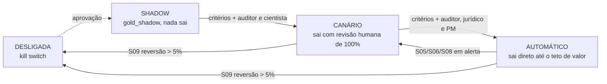

# F10: rollout por regra

> **Status:** desenho implementado e testado (8 testes), com política como dado e a situação calculada sobre o sinistro real em [`STATUS_ROLLOUT.md`](STATUS_ROLLOUT.md).
> **Gate G10 ainda aberto:**
> - histórico de 3 a 6 meses de decisões da auditoria, para o backtest (pedido à Parthenon);
> - workspace com `arvo_prod.gold_shadow`, para rodar o shadow de verdade;
> - aprovação humana de cada promoção (nenhuma regra está apta hoje).

Responde à **pergunta 7 do case** (go-live e monitoramento), junto com a F4 (ambientes) e a F9 (painel).

## A ideia em uma frase
O motor (F6) decide **o que** glosar; o rollout decide **se e como** cada apontamento sai. Isso depende de três entradas versionadas:
- o estágio da regra;
- o portão de sanidade do run (F9);
- o teto de valor que a matriz de custo (F8) permite.

**Promover uma regra é decisão humana registrada. Rebaixar é automático.**

## Estágios de uma regra


## Para onde vai cada apontamento
A primeira regra que casar vence ([`envio.py`](envio.py), [`estagios.yaml`](estagios.yaml)):

| # | Condição | Destino |
|---|---|---|
| 1 | Portão de sanidade fechado (invariante violado, F9) | BLOQUEADO (o run inteiro) |
| 2 | Regra DESLIGADA ou em SHADOW | NAO_ENVIAR (fica em `gold_shadow`) |
| 3 | Regra em CANÁRIO | REVISAO_HUMANA |
| 4 | O motor marcou motivo de revisão (ex.: Pronto Socorro × Eletivo, AMB-01) | REVISAO_HUMANA |
| 5 | Conflito semântico no item | REVISAO_HUMANA |
| 6 | Valor acima do teto da regra | REVISAO_HUMANA |
| 7 | Caso contrário | ENVIO_AUTOMATICO |

**O teto de valor não é arbitrado: sai da matriz de custo (AMB-20).** O envio automático compensa enquanto o custo esperado de um falso positivo for menor que o de uma revisão:

| Limite inferior da precisão (IC 95%) | Teto do envio automático |
|---|---|
| abaixo de 95% (piso do comitê) | R$ 0: nada sai automático |
| 95% | R$ 1.700 |
| 98% | R$ 4.700 |
| 99% | R$ 9.700 |
| qualquer | trava de política em R$ 10.000 |

## Critérios de promoção
Todos são obrigatórios, e a promoção ainda exige aprovação de quem está listado. A ferramenta [`promocao.py`](promocao.py) confere e diz o que falta; ela nunca promove sozinha.

| Critério | SHADOW → CANÁRIO | CANÁRIO → AUTOMÁTICO |
|---|---|---|
| Amostra auditada | ≥ n do plano amostral da F8 (R1 91, R2 40, R3 50, R4 55) | — |
| Precisão auditada | — | ≥ 98% |
| Limite inferior do IC 95% | ≥ 95% | ≥ 95% |
| Violações de invariante | 0 | 0 |
| Reversão projetada | — | ≤ 5% |
| Aderência semântica | 100% | 100% |
| Telemetria completa | sim | sim |
| Integração ponta a ponta | — | sim (o apontamento chega registrado na Parthenon) |
| Tempo no estágio | ≥ 4 semanas | ≥ 4 semanas |
| Aprovadores | Auditor médico e Cientista de dados | Auditor médico, Jurídico e PM/CS |

## Sequência proposta
| Semanas | Etapa | O que acontece | Quem decide |
|---|---|---|---|
| 0–2 | Backtest | Motor contra 3 a 6 meses de decisões reais da auditoria; divergências vão para adjudicação cega (F8) | Cientista + Auditor |
| 0–2 | Regressão em stg | Golden set congelado; toda diferença de apontamentos vs a versão anterior precisa de explicação ([`regressao.py`](regressao.py)) | Engenharia |
| 2–8 | Shadow | Todas as regras em `gold_shadow`; amostra auditada pelo plano da F8 | Auditor |
| 8–12 | Canário, onda 1 | R1 e R3, as mais objetivas | Auditor + Cientista |
| 12–16 | Canário, onda 2 | R2 e R2B, depois do AMB-02 (escopo "conta" do pacote) | Auditor + Cientista |
| 12+ | Automático | R1 e R3, se cumprirem os critérios depois de ≥ 4 semanas de canário | Auditor + Jurídico + PM |
| — | R4 | Fora de Pronto Socorro segue o fluxo normal; em PS × Eletivo fica sempre em revisão (AMB-01) | Jurídico |

**Capacidade de auditoria:** uma rodada do plano amostral tem cerca de 596 itens: 236 glosados (91 + 40 + 50 + 55) e 360 não glosados, para medir o recall. A ~15 min por item, que é a premissa de custo da revisão, são **~150 h de auditoria**. Com dois auditores em meio período, são cerca de 4 semanas, e é isso que define a duração mínima do shadow.

## Situação hoje (com os dados do case)
Detalhes em [`STATUS_ROLLOUT.md`](STATUS_ROLLOUT.md).
- **Todas as regras estão em SHADOW.** Os 369 apontamentos ficam em `gold_shadow`, e nada sai.
- **Nenhuma regra está apta a canário.** A amostra auditada (o gabarito) cobre de 50% a 74% do plano, e o limite inferior do IC fica entre 72% e 88%, abaixo do piso de 95%.
- **Simulação: se todas as regras fossem para AUTOMÁTICO hoje,** o teto de valor seria zero e tudo cairia em revisão humana. O painel de sanidade ainda rebaixaria R1, R2 e R3 (S05) e R4 (S06) para CANÁRIO. Os mecanismos se reforçam: nenhuma regra fica em envio direto sem evidência.

## Monitoramento depois do go-live
É o painel da F9, com estes pontos de atenção:
- **Portão de envio:** qualquer invariante em alerta bloqueia o run inteiro.
- **Rebaixamento automático** por regra:
  - S05 (precisão auditada abaixo de 98%), S06 (limite inferior do IC abaixo de 95%) e S08 (recurso acima do benchmark) rebaixam para CANÁRIO.
  - S09 (reversão acima de 5%) desliga a regra.
- **Auditoria contínua:** uma amostra mensal pelo mesmo plano, com peso amostral, mantém a precisão medida, e a amostra dos não glosados mede o recall.
- **Rastreabilidade:** cada mudança de estágio entra no histórico ([`estado_regras.yaml`](estado_regras.yaml) e `ops.rollout_estado_regra`) com data, motivo e aprovadores, ou com `automatico:<indicador>`.

## Arquivos
| Arquivo | O que faz |
|---|---|
| [`estagios.yaml`](estagios.yaml) | Estágios, destinos, precedência, critérios, rebaixamento e ondas (política como dado) |
| [`estado_regras.yaml`](estado_regras.yaml) | Estágio vigente de cada regra e histórico |
| [`envio.py`](envio.py) | Destino de cada apontamento (Spark) e teto de valor pela matriz de custo |
| [`promocao.py`](promocao.py) | O que falta para promover; rebaixamento automático a partir do painel |
| [`regressao.py`](regressao.py) + [`explicacoes/`](explicacoes/) | Gate de stg: toda diferença entre versões explicada |
| [`backtest.py`](backtest.py) | Motor contra o histórico real da auditoria (contrato do histórico definido) |
| [`status.py`](status.py) | Gera `STATUS_ROLLOUT.md` com o sinistro real |
| `databricks/` · `notebooks/` | `ops.rollout_estado_regra`, `ops.rollout_destino`, `gold_shadow.fato_apontamento` e o job `f10_rollout` |

## Rodar
```bash
python -m rollout.status
```
```bash
pytest rollout/tests -v
```
