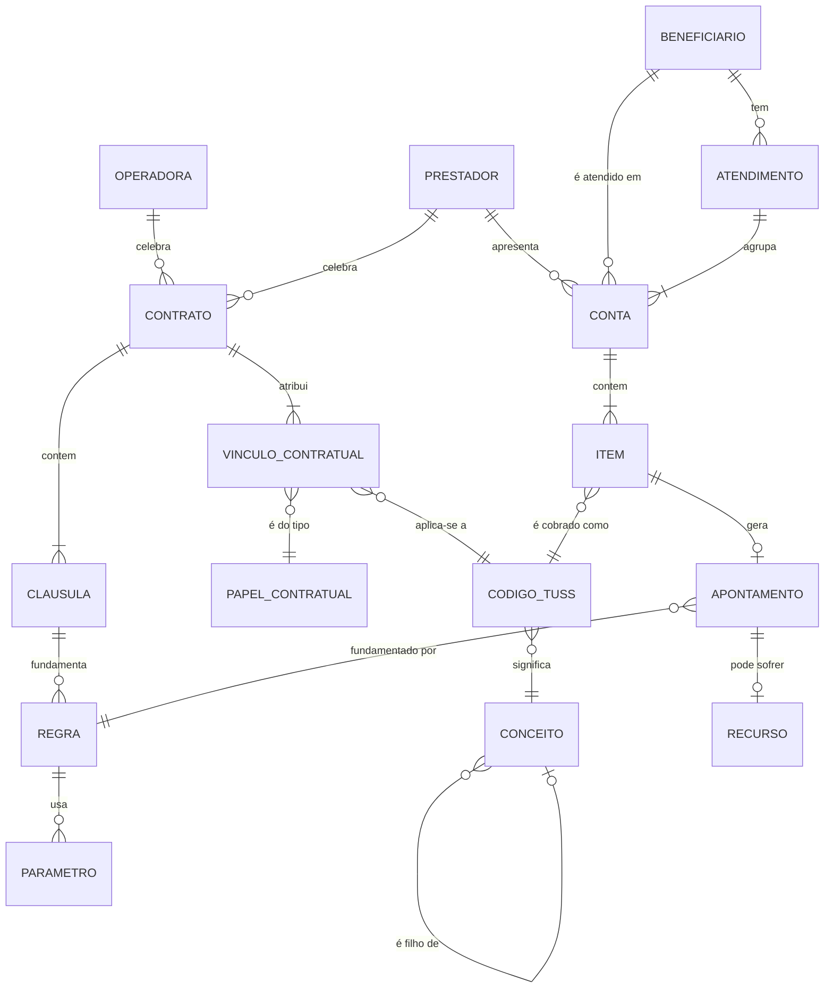

# Ontologia: modelo de entidades do domínio

> Status: **rascunho, pendente do Gate G2.** Fonte da verdade dos termos: [`glossario.yaml`](glossario.yaml).

## 1. Entidades e relações



| Entidade | Chave | Origem | Grão / observação |
|---|---|---|---|
| CONTRATO | `id_contrato` + `versao_contrato` | PDF → F3 | Versão imutável aprovada pelo Jurídico |
| CLAUSULA | `id_contrato` + número | F3 | Texto literal preservado (citação) |
| REGRA | `regra_id` + `versao_regra` | Motor (F6) | Referencia **apenas conceitos e papéis**, nunca colunas cruas |
| VINCULO_CONTRATUAL | contrato + papel + código | F3 ([`vinculos/`](vinculos/)) | O que o contrato diz sobre cada código |
| PAPEL_CONTRATUAL | `id` | [`conceitos.yaml`](conceitos.yaml) | Universal: preço pactuado, pacote, incluso, excluído, condicionado ao caráter |
| CONTA | `id_conta` | Sinistro | Escopo do pacote (Cl. 3.2). 1 beneficiário, 1 data, 1 caráter e 1 regime por conta (verificado em jun/2025) |
| ITEM | `id_item` | Sinistro | **Grão da auditoria** |
| CODIGO_TUSS | `cod_tuss` | Sinistro e contrato | Chave de negócio. A descrição não é chave |
| CONCEITO | `id` | [`conceitos.yaml`](conceitos.yaml) | Universal, independente de prestador |
| BENEFICIARIO | `id_beneficiario` | Sinistro | Dado pessoal sensível: hash/máscara fora de prod |
| ATENDIMENTO | beneficiário + data | **Derivado** | Detecta fragmentação de conta e sobreposição (AMB-02, AMB-08) |
| APONTAMENTO | `id_apontamento` | Gold | 1 por item glosado. Principal e subsidiárias, evidência e versões |
| RECURSO | `id_recurso` | Futuro | Necessário para taxa de recurso e de reversão |

## 2. Hierarquia de conceitos

```mermaid
graph TD
    PROCEDIMENTO --> PROCEDIMENTO_CIRURGICO
    PROCEDIMENTO --> CONSULTA
    TAXA --> TAXA_SALA_CIRURGICA
    TAXA --> TAXA_URGENCIA_EMERGENCIA
    DIARIA --> DIARIA_ENFERMARIA
    DIARIA --> DIARIA_UTI
    SADT --> SADT_LABORATORIO
    SADT --> SADT_IMAGEM
    MATERIAL --> MATERIAL_SUTURA
    MATERIAL --> MATERIAL_COMPRESSA
    MATERIAL --> MATERIAL_ESPECIAL
    MEDICAMENTO --> MEDICAMENTO_ANTIMICROBIANO
    MEDICAMENTO --> MEDICAMENTO_ANALGESICO
```



## 3. As duas camadas (por que escala para outros hospitais)

```
          CONCEITO (universal)                    PAPEL CONTRATUAL (por contrato)
  70520020 → MATERIAL_SUTURA        ──PRT-2025-0417──▶  ITEM_INCLUSO_NO_PACOTE (material de rotina)
  20103077 → TAXA_SALA_CIRURGICA{4} ──PRT-2025-0417──▶  ITEM_INCLUSO_NO_PACOTE de 31001012 e 30715016
  99999001 → TAXA_URGENCIA_EMERG.   ──PRT-2025-0417──▶  TAXA_CONDICIONADA_AO_CARATER [URGENCIA_EMERGENCIA]
```

- A **regra** é escrita sobre papéis. Exemplo: "item com papel ITEM_INCLUSO_NO_PACOTE numa conta que contém PROCEDIMENTO_EM_PACOTE gera glosa integral".
- Num outro hospital, muda só o **vínculo**. O conceito, a regra e a métrica continuam os mesmos.
- É também o que permite a um agente analítico perguntar "em qual cirurgia há gap recorrente vs contrato?" atravessando vários contratos.

## 4. Três eixos que não podem ser confundidos

| Eixo | Campo | Valores canônicos | Pergunta que responde |
|---|---|---|---|
| **Caráter** | `carater_atendimento` | ELETIVO, URGENCIA_EMERGENCIA | *Qual a natureza clínica?* (é o que a Cl. 4.1 usa) |
| **Regime** | `tipo_conta` | INTERNACAO, AMBULATORIAL, PRONTO_SOCORRO | *Onde ou em que regime?* |
| **Item** | `cod_tuss` 99999001 | TAXA_URGENCIA_EMERGENCIA | *O que foi cobrado?* |

No sinistro de jun/2025 os três eixos se cruzam de todas as formas:

| | Ambulatorial | Internação | Pronto Socorro |
|---|---|---|---|
| **Eletivo** | 145 itens | 1.073 itens | **114 itens** |
| **Urgência** | 66 itens | 242 itens | 56 itens |

Por isso nenhuma regra pode usar "Pronto Socorro" como sinônimo de urgência (AMB-01).
